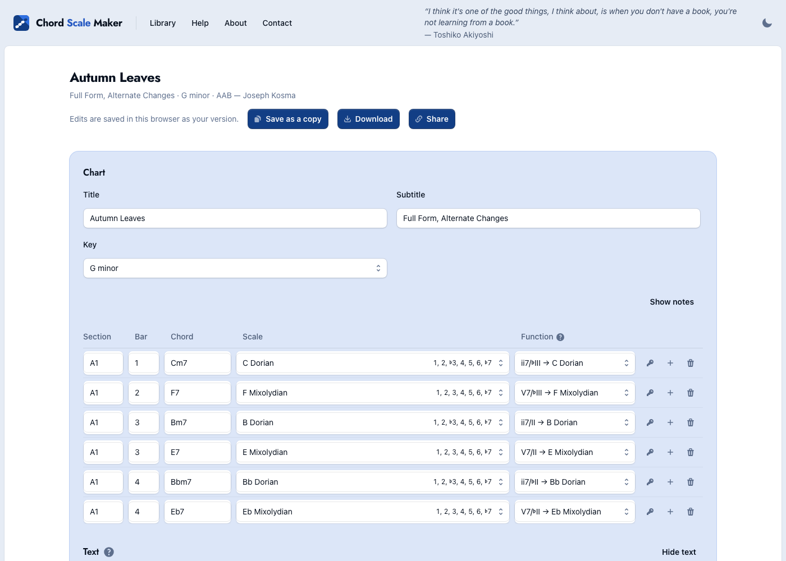
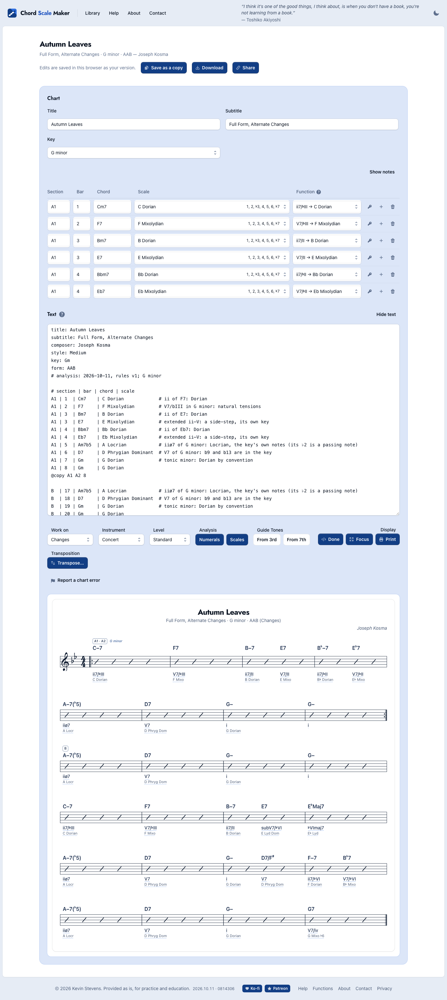
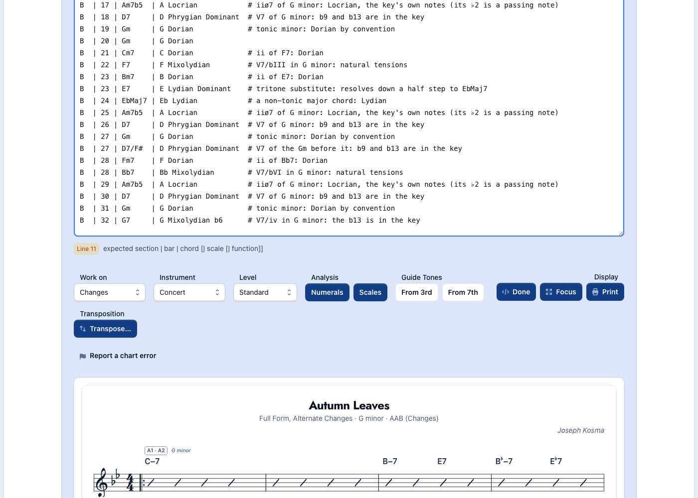
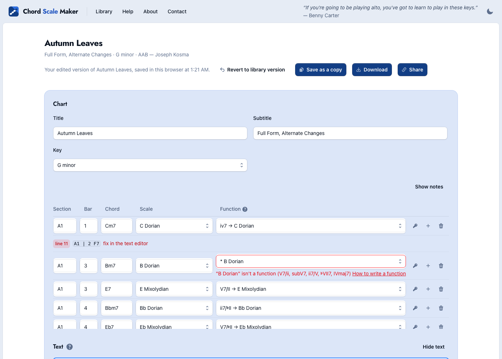
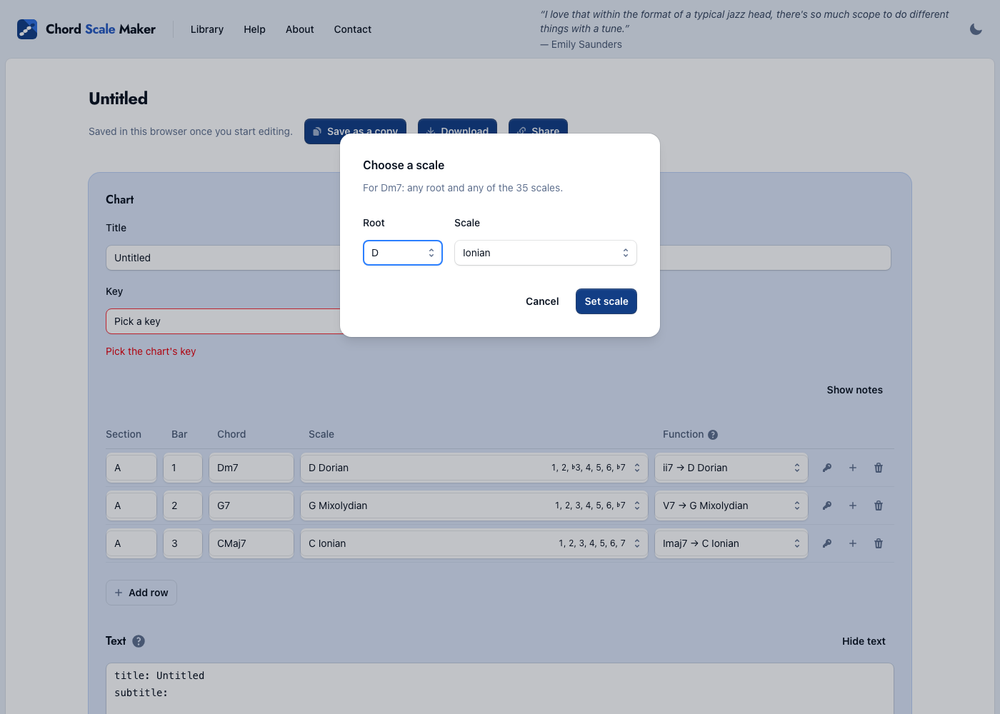
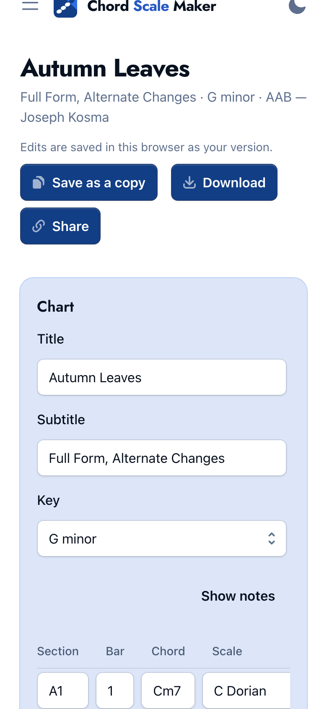
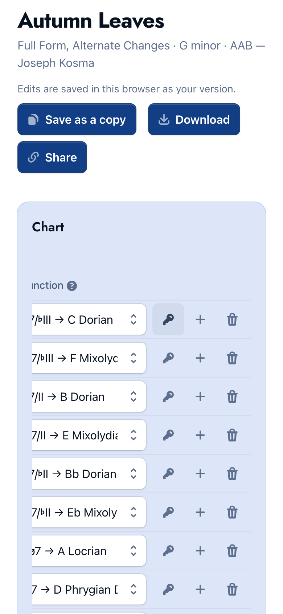
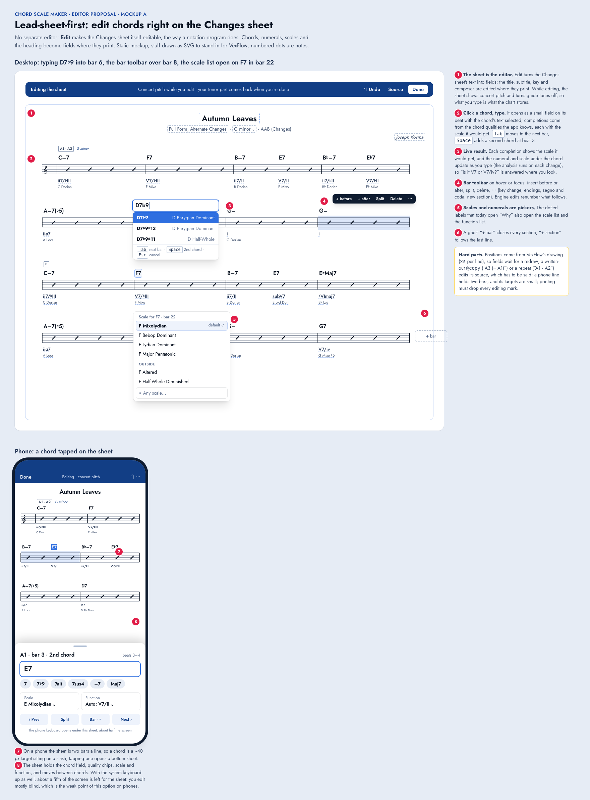
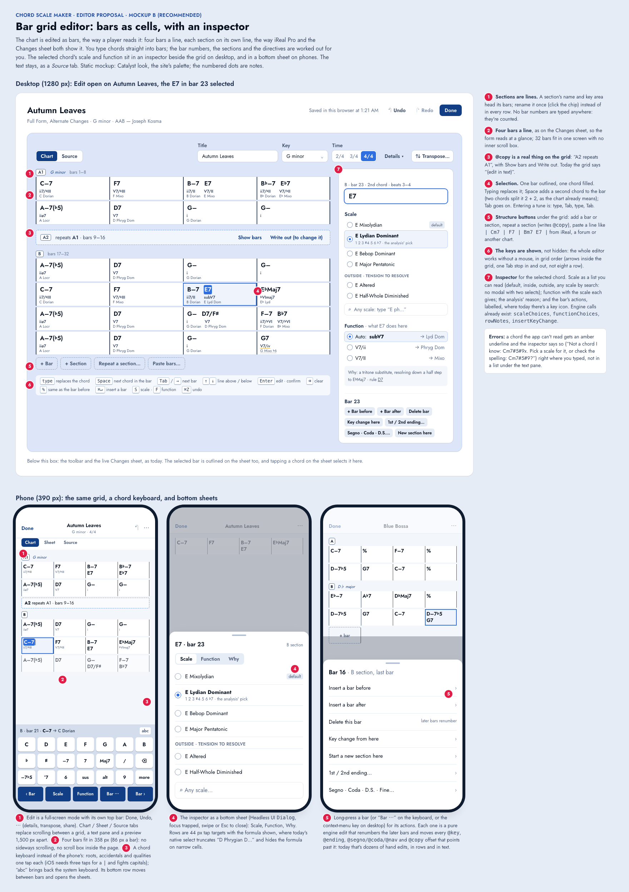
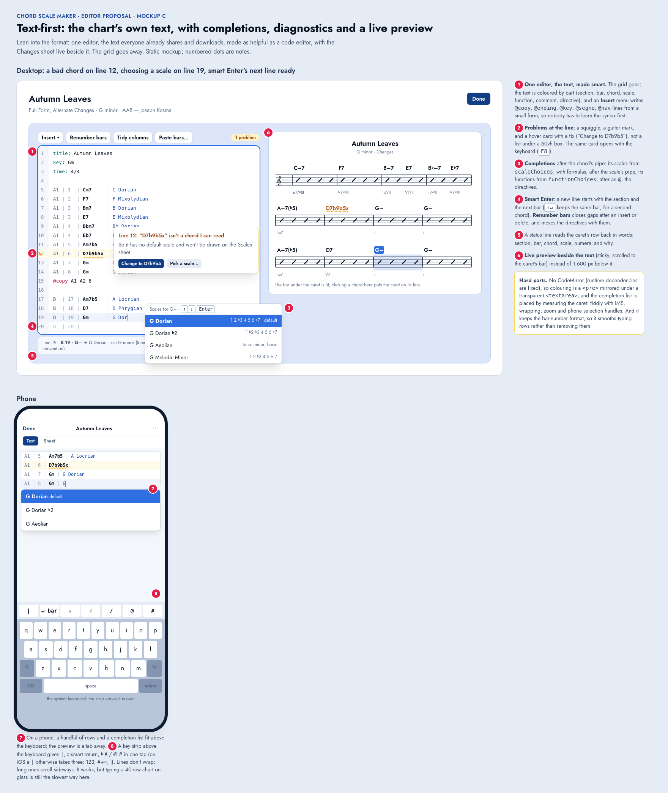

# Editor UX: three alternatives, one recommended

**Status:** proposal for review, 2026-10-11. Nothing is built: this folder holds the findings, three static mockups and
screenshots. The app is unchanged.

**In short:** today's editor is a table of chord *rows*, and every row has a section name and a bar number typed by
hand. That one choice causes most of the pain: you can't see the form, inserting or deleting a bar means renumbering
everything after it, and on a phone the table is 2.5 screens wide. I recommend **B, a bar grid editor**: bars as
cells, four to a line, typed into directly, with an inspector for the selected chord's scale and function. It is
plain HTML on the existing engine, so it needs no new dependency, and it can ship in stages behind a `barEditor`
flag. A (edit on the Changes sheet) is the most striking option but the riskiest. C (smart text) is the cheapest
but keeps the row format's problems.

| | Mockup | Screenshot |
| --- | --- | --- |
| A. Lead-sheet-first | [mockup-a-lead-sheet.html](mockup-a-lead-sheet.html) | [img/mockup-a-lead-sheet.png](img/mockup-a-lead-sheet.png) |
| **B. Bar grid + inspector (recommended)** | [mockup-b-bar-grid.html](mockup-b-bar-grid.html) | [img/mockup-b-bar-grid.png](img/mockup-b-bar-grid.png) |
| C. Smart text | [mockup-c-smart-text.html](mockup-c-smart-text.html) | [img/mockup-c-smart-text.png](img/mockup-c-smart-text.png) |

The mockups load Tailwind and Jost from CDNs. That's fine for a static proposal; none of it is app code.

---

## 1. Today's editor, as built

Read from `EditorView.vue`, `ChartGrid.vue`, `GridCell.vue`, `ScaleCell.vue`, `FunctionCell.vue`, `ChartText.vue`,
`ChartTranspose.vue`, `PreviewControls.vue`, `useChartEditor.ts`, `engine/edit.ts`, `engine/chart.ts`,
`engine/notes.ts` and `e2e/editor.spec.ts`, and from running the dev build at 1400 px and at 390 px (iPhone-sized,
touch, 2× DPR).

- **Song-first.** `/song` opens on the Changes sheet with the editor hidden. **Edit** sits in the toolbar's
  *Display* group, beside Focus and Print.
  ([img/today-desktop-song.png](img/today-desktop-song.png))
- **Edit shows two editors of one `ChartDoc`.** At the top is a *Chart* grid: title, subtitle and key fields, then a
  table with one row per chord (Section, Bar, Chord, Scale select, Function select, then key-change, add and delete
  buttons). Under it is a *Text* pane, the raw chart in a 60vh textarea with diagnostics listed underneath. With the
  `functions` flag the text sits below the grid and can fold away. The grid lives in its own `max-h-[60vh]` scroll box.
- **Sync** goes through `useChartEditor`. Typing in the text is parsed after 150 ms. A grid edit makes a new doc and
  rewrites the text in canonical form. The text always wins.
- **The preview** (toolbar and sheet) comes after both editors.

## 2. What's hard today

Each finding comes from the code or a screenshot in `img/`.

### 2.1 Bar numbers and sections are typed by hand on every row
- A chord's place in the tune is its `section | bar` text. Two chords in a bar are two rows with the same number.
- **Add row** (`insertRowAfter`) copies the section *and the bar* from the row above. So every new bar means editing
  the bar cell (click, select, type) before you can type the chord.
- **Inserting or deleting a bar renumbers nothing.** A missing number becomes a held bar: I checked with
  `buildChanges`, and rows numbered 1, 2, 4 draw bar 3 empty, with F7 holding. To add a bar after bar 20 of
  *Autumn Leaves*, you edit the bar cell of all 12 rows after it, then fix any `@copy` offset, `@key`, `@ending` and
  `@nav` by hand, in the text. Nothing warns you.
- Renaming a section (A1 → A) means editing the section cell of every row in it, plus the `@copy` line in the text.

### 2.2 The edit view is a database table, not music
- The table doesn't show the form. You can't see four-bar phrases or where A ends, and two chords in a bar look like
  two bars.
- *Autumn Leaves* is 30 rows. In the 60vh box that's about 9 rows a screen, with no section breaks.

### 2.3 The editor and the result are far apart
- With the editor open, the sheet starts **1,665 px** down the page on desktop and about **1,550 px** down on a
  phone (measured).
- Every change means: scroll down to see it, scroll back up, find the row again.
- 

### 2.4 Structure lives only in the text, and some of it is invisible in the grid
- `ChartGrid` draws only `row`, `copy`, `key` and `invalid` lines. **`@ending`, `@segno`, `@coda`, `@nav`,
  `@context` and comments don't appear in the grid at all.**
- `@copy` shows as "(edit in text)".
- `time:`, `composer:`, `style:` and `form:` can only be set in the text.
- So endings, repeats, D.S. al Coda and 3/4 all need the README's syntax.

### 2.5 Two editors, and the error feedback sits in the wrong place
- Diagnostics are listed **under** the textarea, 612 px below its top (measured), not at the line.
- A bad line shows in the grid as "line 11 … fix in the text editor".
- The preview doesn't flag a bad line: it just draws an empty bar. Break `A1 | 2 | F7` and the Changes sheet shows
  C–7, an empty bar, B–7, with the one diagnostic out of sight below the textarea.
- 
- Pipes are positional, so one slip moves a value into the wrong column. In the screenshot, one extra `|` put the
  scale into the function cell, and the grid reports *"B Dorian" isn't a function*. That's true, but it doesn't
  help you fix the line.
- 
- On a new chart the key starts blank, with a red **Pick the chart's key** error and Transpose disabled, even though
  the starter chord rows are fine ([img/today-desktop-new.png](img/today-desktop-new.png)).

### 2.6 Keyboard flow
- **8 Tab stops a row**: section, bar, chord, scale, function, key, add, delete. Crossing *Autumn Leaves* takes
  about 240 Tabs.
- There's no arrow navigation and no Enter-for-next.
- **There's no undo.** A grid edit rewrites the textarea's value from code, which in practice also drops the
  browser's own undo history for the textarea.

### 2.7 Choosing a scale or a function
- The scale is a native select with long labels. The formula shows only when the cell is wide enough.
- **Other…** opens a modal with two more selects (root, name) and a button: about 6 actions for one scale.
- 
- Function options read `ii7/♭III → C Dorian`, which is useful but wide. The help is a `?` link to another page.
- The key-change action is an unlabelled key icon.

### 2.8 Phone layout
At 390 px:
- **The page is 500 px wide.** The Display group (Edit, Focus, Print) runs off the right edge, so the whole page
  scrolls sideways ([img/today-phone-song.png](img/today-phone-song.png)).
- **The table is 753 px wide in a 306 px column.** Function and the row actions are 2.5 screens to the right
  ([img/today-phone-grid-scrolled.png](img/today-phone-grid-scrolled.png)).
- Chord cells cut off "Am7b5" as "Am7k" ([img/today-phone-grid-box.png](img/today-phone-grid-box.png)).
- **Three scrollers are nested**: the page, the 506 px grid box and the table's sideways scroll. The title, subtitle
  and key fields fill most of the box's first screen, so only two chord rows show until you scroll *inside* it.
- The text pane wraps every row, so the columns turn into word soup
  ([img/today-phone-editor-full.png](img/today-phone-editor-full.png)).
- Typing a `|` on iOS takes three taps (123, #+=, |), and a row has two to four of them.

 

### 2.9 Discoverability
- Edit is filed under "Display".
- Endings, segno and coda, `@copy` and `time:` have no UI at all.
- **Show notes** quietly adds a column.
- The function column's meaning is on another page.

### Counting rules
- **Actions** are clicks or taps plus navigation keys (Tab, Enter, arrows, select-all).
- **Syntax keystrokes** are the characters you type that aren't the chord itself (section names, bar numbers, pipes,
  `@` directives).
- Chord symbols are the same in every design, so they aren't counted.
- "+ scroll" means finding a row in the grid's scroll box, or scrolling to the sheet and back.
- Start state: a chart open on `/song`, editor closed. Desktop unless noted.

## 3. The alternatives

All three keep the model as it is: `ChartDoc`, `parseChart` and `serializeChart`, the text format and `charts/`.
`useChartEditor` stays the single source of truth, and saving, sharing and download are untouched. The golden
fixture doesn't change: no engine output changes, only new pure functions with their own tests.

These pure engine pieces help any of the three:

| New, pure, in `web/engine/` | Does |
| --- | --- |
| `bars.ts`: `barView(doc)` | The doc as sections → bars → chords, each chord with its `line` index (from `expandRowLines`). Held or implied bars are marked, `@copy` sections are linked, and endings, marks, nav and key areas are attached to bars. |
| `edit.ts`: bar operations | `insertBar`, `deleteBar`, `setBarChords`, `renameSection`, `addSection`, `repeatSection` (writes `@copy`), `setEnding`, `setMark`, `setNav`. Each shifts later rows **and** every `@key`, `@context`, `@ending`, `@segno`/`@coda`/`@nav` and `@copy` offset past the edit, and keeps row comments. |
| `parseBarLine('\| Cm7 \| F7 \| Bm7 E7 \|')` | Pasted or typed bars become rows (iReal, forum and lead-sheet style). |
| `chordCompletions(prefix)` | Completions from the chord qualities in `chord_scales.json`, each with its default scale. |
| History | Every edit is a new immutable `ChartDoc`, so undo is a stack of docs (`useChartHistory`, a few lines). Worth doing whichever option is chosen. |

The ones that already exist and get reused: `setRowChord` and `setRowField`, `scaleChoices`, `functionChoices`,
`rowNotes`, `insertKeyChange`, `transposeChart`, `isValidKey`, `cellError`.

---

### A. Lead-sheet-first: edit on the Changes sheet

**Core interaction.** Edit turns the Changes sheet itself into the editor:
- Click a chord on its beat and it opens as a small field with completions, each completion showing the scale it
  would get.
- **Tab** moves to the next bar. **Space** adds a second chord at beat 3.
- The numeral and scale labels under each chord, which today open "Why", also open the function and scale lists.
- Hovering or focusing a bar shows a toolbar: insert before or after, split, delete, ⋯ (key change, endings, segno
  and coda, new section). A ghost "+ bar" closes each section.
- The heading (title, subtitle, key, composer) is edited where it prints.
- While editing, the sheet shows concert pitch with guide tones off, so what you type is what's stored.

**Phone.**
- The sheet is two bars a line. A chord is a ~40 px target sitting on a slash.
- Tapping one opens a bottom sheet: chord field, quality chips, scale, function, prev and next.
- With the system keyboard up as well, about a fifth of the screen is left for the sheet. You edit mostly blind.

**Accessibility.**
- Chords become buttons in reading order, but they sit on a drawing: positions come from VexFlow, and labels are
  absolutely placed.
- A screen-reader or keyboard-only author needs a separate, non-visual way in (keep a Source tab).
- This is the weakest of the three for accessibility.

**Reuses** the `buildChanges` layout (each `ChangesChord` already carries `at: {section, bar}`; add its `line`),
`ChangesSystem`'s HTML overlay, `ChangesNote`'s popover, and the engine operations above.

**Effort: L. Risks:**
- Fields are placed from VexFlow's `xs`, so they wait for a redraw, and a commit redraws the line.
- A repeat drawn with repeat signs ("A1 · A2") or written out as "A3 (= A1)" edits its *source*, which has to be
  explained.
- Editing a transposed part means converting written pitch back to concert, or forcing concert while editing (the
  mockup forces it).
- Printing must drop every editing mark.
- Guide-tone mode changes the layout.
- No new dependencies are needed, and the CSP is fine: overlays are Vue, and inline style attributes are already
  allowed by `style-src 'unsafe-inline'`.

### B. Bar grid editor with an inspector (recommended)

**Core interaction.** The *Chart* tab of Edit shows the tune as bars: four cells to a line, each section on its own
line, headed by its name chip and key area.
- **Typing.** Typing replaces the selected chord. **Space** adds a chord to the bar (two chords split it 2 + 2, as
  the format already means). **Tab** or **→** moves to the next bar, **↑ ↓** to the line above or below. `%`
  repeats the previous bar, and **⌘Z** undoes.
- **Entering a tune** is just: type, Tab, type, Tab. Bar numbers are counted, never typed.
- **Repeats.** `@copy` is a visible, collapsed line ("A2 repeats A1 · bars 9–16") with **Show bars** and **Write
  out**.
- **Structure buttons** under the grid: + Bar, + Section, Repeat a section…, and Paste bars… (`| Cm7 | F7 | Bm7 E7
  |`).
- **The inspector** (right on desktop, a bottom sheet on phones) shows the selected chord:
  - its scale as a readable list: default, inside, outside, then any scale by search, with no two-select modal;
  - its function, with the scale each choice gives;
  - the analysis' *why*;
  - the bar's actions, labelled: insert, delete, key change, endings, segno/coda/D.S., new section.
- **Errors.** A chord the app can't read gets an amber underline in its cell, and the inspector explains it and
  suggests a fix.
- **Text** stays as a *Source* tab: same text, same sync, for power users and for anything the grid doesn't model.
- **The sheet below** outlines the selected bar, and tapping a chord on the sheet selects it in the grid. That brings
  A's best idea in at low cost.

**Phone.**
- Edit becomes a full-screen mode: a top bar with Done, Undo and ⋯ (details, transpose, share), and
  **Chart / Sheet / Source** tabs. No 1,500 px scroll between editor and result.
- Four bars fit in 358 px (86 px a bar), with no sideways scroll and no scroll box inside the page.
- **A chord keyboard** replaces the system one: roots, ♭ ♯, qualities and `/`, one tap each. Its bottom row has
  ‹ Bar, Scale, Function, Bar ⋯, Bar ›. "abc" brings back the system keyboard. No autocorrect, no capitals fight, no
  three-tap pipe.
- The inspector and the bar menu are bottom sheets (Headless UI `Dialog`), with 44 px rows.

**Accessibility.**
- The WAI-ARIA **grid** pattern: one Tab stop into the grid, arrows inside it, roving `tabindex`, and
  `aria-rowindex`/`aria-colindex`.
- Each cell is labelled "B, bar 23: B minor 7, E7".
- The inspector's lists are radiogroups. A polite live region reads back each change ("E7: subV7, E Lydian
  Dominant").
- Bottom sheets are modal dialogs with their focus trapped. Every action is in a menu as well as a gesture
  (long-press has a button equivalent).
- The Source tab remains a plain textarea.
- The mockup's keyboard legend is part of the UI: the shortcuts are shown, not hidden.

**Reuses** `barView` and the bar operations above, plus `scaleChoices`, `functionChoices`, `rowNotes`,
`insertKeyChange`, `transposeChart` and `cellError` (chord-cell validation). It also reuses `ChartText` (Source) and
the Catalyst `Dialog`, `Listbox`, `Button` and `Badge` components. `ChartGrid`, `GridCell`, `ScaleCell` and
`FunctionCell` retire at the end.

**Effort: L in total, shipped as M-sized stages. Risks:**
- An accessible grid widget is real work. Plan for screen-reader testing (VoiceOver and NVDA).
- Held or implied bars, and charts that number bars oddly ("1a", gaps on purpose), have to show faithfully:
  `barView` marks what it can't place, and those rows stay editable in Source.
- Three or more chords in a bar: the format allows it, and the grid should too (Space adds more).
- A custom chord keyboard has to feel native. Keep "abc" one tap away.
- e2e builds with **every** flag on, so the editor tests (`editor.spec.ts`, `functions.spec.ts`,
  `my-charts.spec.ts`) must pass with the bar editor on from its first PR. Port them in stage 1.
- No new dependencies, and nothing touches the CSP. The engine stays free of Vue and the DOM.

### C. Text-first: the chart's text, made smart

**Core interaction.** Drop the grid and make the text excellent, with the Changes sheet live **beside** it:
- **Colouring** by part: section, bar, chord, scale, function, comment, directive.
- **Completions**: after the chord's pipe, its scales with their formulas; after the scale's pipe, its functions;
  after `@`, the directives.
- **Problems at the line**: a squiggle, a gutter mark, and a hover or **F8** card with a quick fix.
- **Smart Enter** starts the next line with the section and the next bar; ⇧↵ keeps the same bar.
- **Renumber bars**, **Tidy columns**, and an **Insert** menu that writes `@copy`, `@ending`, `@key`, `@segno` and
  `@nav` from a small form.
- A status line reads the caret's row back in words, and the bar under the caret is lit on the preview.

**Phone.**
- Text and Sheet tabs, with a key strip above the system keyboard: `|`, smart return, ♭ ♯ / @ #.
- Lines don't wrap.
- Good for a quick fix, slow for entering a tune.

**Accessibility.**
- The best baseline: a native textarea.
- Completions as a combobox using `aria-activedescendant`, and diagnostics linked by `aria-describedby` and also
  listed.

**Reuses** `ChartText`, `parseChart` diagnostics (they already carry line numbers), `scaleChoices`,
`functionChoices`, `rowNotes`, plus `parseBarLine` for Paste bars and the renumbering from the bar operations.

**Effort: M. Risks:**
- No CodeMirror, because runtime dependencies are fixed. So colouring is a `<pre>` mirrored under a transparent
  `<textarea>`, and completions are placed by measuring the caret. That's fiddly with IME, zoom, wrapping and phone
  selection handles.
- It keeps the row format, so it smooths typing bar numbers rather than removing them, and the form still isn't
  visible while you edit.

---

## 4. Comparison

Actions and syntax keystrokes per task (counting rules in §2). "≈" means rounded; the method is in the appendix.

| Task | Today | A. On the sheet | **B. Bar grid** | C. Smart text |
| --- | --- | --- | --- | --- |
| Enter a 32-bar AABA, 40 chords (A2 and A3 repeat A1) | ≈190 actions in the grid (it can't repeat a section), or ≈180 syntax keystrokes in the text | ≈35 | **≈30** | ≈40 |
| Change one chord (bar 21) and see the result | 5 + 2 scrolls; phone: + nested scroll | **2** | 3 (2 while editing) | 3–4 |
| Pick an alternate scale | 3 + scroll | **2** | **2** | 3 |
| Any scale ("Other…") | 8 + scroll | 3–4 | 3–4 | 3–4 |
| Add 1st/2nd endings | text only, ≈32 syntax keystrokes; invisible in the grid | 4 | 4 | ≈6 (Insert form) |
| Insert a bar mid-tune (after bar 20 of *Autumn Leaves*) | ≈40 (renumber 12 rows by hand, then fix directives) | **2** | **2** | ≈5 (insert line, Renumber) |
| Rename a section | ≈25 (every row, plus `@copy`) | 2–3 | 2–3 | ≈5 |
| Transpose | 4 | 4 | 4 | 4 |
| State a function | 3 + scroll; phone: 2.5 screens sideways | **2** | **2** | ≈4 |
| Key change from a bar | 3 + Edit + scroll | 4 | 4 | 4 |
| Undo | none | ⌘Z | ⌘Z | ⌘Z |
| **Phone** | page 110 px too wide, 3 nested scrollers, 2 rows visible | cramped: 2 bars a line, ~40 px targets, little room with the keyboard up | **designed for it**: 4 bars a line, chord keyboard, bottom sheets, tabs | fine for fixes, slow to enter |
| **Sees the form while editing** | no | yes (the real sheet) | **yes** (bars, 4 a line) | beside it, not in it |
| **Accessibility** | labelled inputs, 8 Tab stops a row | weakest (a drawing) | strong if the grid pattern is done well | strongest baseline |
| **Effort** | | L | L (in M stages) | M |
| **Main risk** | | VexFlow coupling, transposed parts, phone | an accessible grid; odd bar numbering | a hand-rolled code editor; keeps bar numbers |

## 5. Recommendation and a staged path

**Build B.** Its gains come from fixing the model the UI shows, not from polish:
- bars instead of rows;
- bar numbers counted, not typed;
- structure as first-class actions.

That's where today's worst numbers come from (≈190 actions to enter a tune, ≈40 to insert a bar, an unusable
phone layout). A matches B on desktop and wins the "wow", but costs more and does worse on phones and for
accessibility. C is a good Source tab, not a primary editor. B takes the best of both: tap a chord on the Changes
sheet to edit it (from A), and Paste bars and completions in Source (from C).

**Staged path.** The new flag is `barEditor` in `runtimeConfig.public.features`, **off** by default. It's on in e2e
builds, as every flag is.

0. **Small fixes worth doing anyway** (no flag, small, independent of the choice):
   - stop the phone's sideways overflow (let the Display group wrap);
   - drop the nested `max-h-[60vh]` box below `sm`;
   - start a new chart with `key: C`, the key its starter chords are in;
   - add `useChartHistory` undo for the current editor.
1. **Engine first** (TDD, no UI): `barView`, the bar operations with directive renumbering, `parseBarLine`, and
   history. Golden unchanged.
2. **`barEditor` stage 1, desktop:**
   - the bar grid replaces the row table when the flag is on;
   - selection, typing, Space and Tab, arrows, undo;
   - an inspector with Scale, Function and Why;
   - the text becomes the Source tab, built on the existing `ChartText`;
   - port the editor e2e tests (e2e runs with flags on).
3. **Stage 2, structure:** + Bar, + Section, the bar menu (insert, delete, key change, endings, segno/coda/nav),
   Repeat a section, Write out a copy, Paste bars, and time and details in the header strip.
4. **Stage 3, phone:** full-screen Edit with Chart / Sheet / Source tabs, the chord keyboard, and bottom sheets.
5. **Stage 4:**
   - tap a chord on the Changes sheet to edit it there;
   - move Edit next to the title;
   - sign off, turn the flag on in `nuxt.config.ts`, then remove `ChartGrid`, `GridCell`, `ScaleCell`'s select and
     `FunctionCell`.

Each stage is its own PR, with unit tests alongside the engine work and e2e for the UI.

## 6. Questions for you

1. **Concert pitch while editing?** The grid could show the chords in your instrument's key and convert on entry.
   The mockups keep the grid in concert pitch, the chart's own pitch, and label it.
2. **Numerals and scales in the grid:** always shown (as mocked), or a toggle? They're the analysis' live reading,
   and useful while choosing.
3. **Chord keyboard on phones:** worth building in stage 3, or start with the system keyboard plus a quality-chip
   strip?
4. Should **Source** stay visible to everyone, or move under ⋯ once the grid covers endings and marks?

---

### Appendix: method

- **Screenshots of today**
  - The dev server ran from this worktree on port 3311; 4174 is reserved for another worktree's e2e.
  - Playwright Chromium took them at 1400×1000 and at 390×844 (mobile, touch, 2× DPR):
    `img/today-desktop-*.png` and `img/today-phone-*.png`.
  - The measured numbers (page width 500 px on the phone, table 753/306 px, sheet offsets, diagnostics offset) come
    from `getBoundingClientRect` and `scrollWidth` in the same run.
- **The held-bar behaviour** (rows 1, 2, 4 draw bar 3 empty) was checked with `buildChanges` in a throwaway vitest
  file, since deleted.
- **Counting**
  - *Today, grid, a new bar*: Add row, click Bar, select, type the number, Tab, then the chord: ≈5.5 actions.
  - *Today, grid, a second chord in a bar*: Add row, click Chord: 2.
  - *Today, text, one row*: ≈7–9 syntax keystrokes (`A1 | 12 | ` and Enter).
  - *B*: one separator (Tab or Space) a chord; Repeat a section is 3; a section is 2.
  - *A* is as B, plus starting each section from its ghost bar.
  - *C*: one Enter a row, plus Insert forms for `@copy`.
- **Mockups:** static HTML (Tailwind CDN, Jost), with the site's `zinc` and `note` palettes copied from
  `web/app/assets/css`. A and C were written by a small script, B by hand. The screenshots come from Playwright at a
  1760 px viewport.
